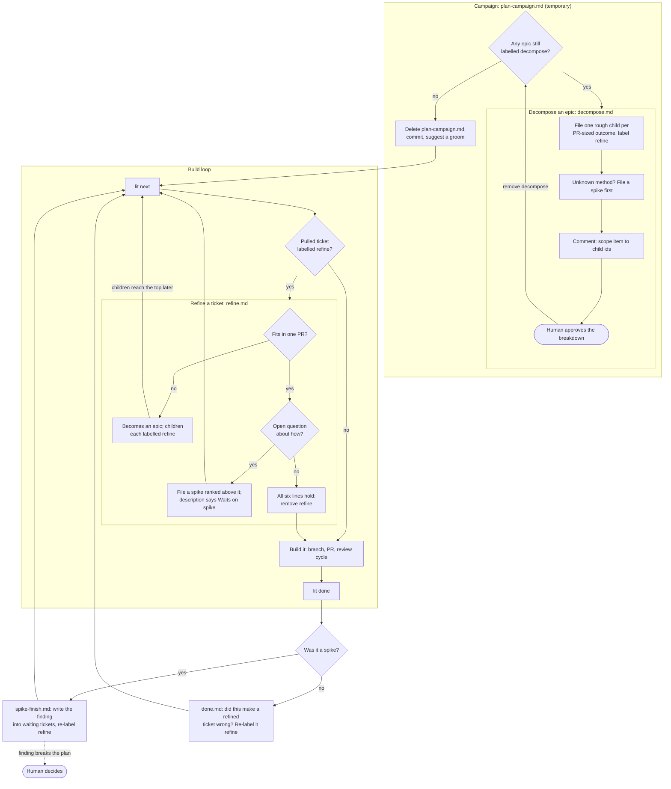
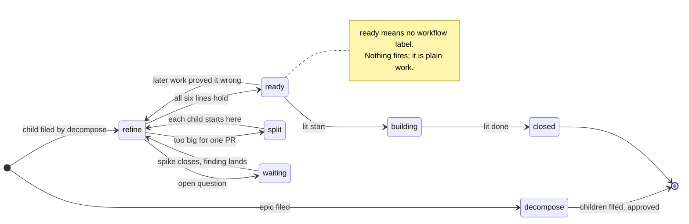

# Planning workflow

This project plans and builds its backlog through four nested cycles. Each is driven by a lit workflow file in `.lit/workflows/` (see `lit workflows --help`). The cycles are: break every epic into tickets; refine each ticket just before it's built, splitting it if it's too big; carry each research finding into the tickets that waited on it; and reopen planning on anything a finished ticket proved wrong. An agent runs all of it by using lit normally. The guidance appears in lit's own output at the moment it applies.

The setup is also meant as a worked example of lit workflows. The [last section](#how-the-workflow-files-are-built) explains the techniques it uses.

## The cycles at a glance

The two rounded nodes are the only points where a person signs off: approving an epic's breakdown, and deciding what to do when research shows part of the plan won't work.

## A ticket's life, by label

A label is a ticket's position in the process. A ticket follows the workflow while it carries the label and leaves it the moment the label is removed.

A spike is a ticket with both `spike` and `refine`. It goes through the same path, gets its own guidance while it's worked (`spike-start.md`), and triggers `spike-finish.md` when it closes.

## What each file does

| File | Fires when | Stop condition the agent checks |
| --- | --- | --- |
| `plan-campaign.md` | Any backlog view or `lit next` | `lit ls --labels decompose --status open` is empty. The agent then deletes the file. |
| `decompose.md` | An epic labelled `decompose` is shown or started | Every Scope item maps to a child in a comment on the epic, and the user approved the breakdown. |
| `refine.md` | A ticket labelled `refine` is shown, pulled, or started | Six lines hold: what and why, a runnable "Done when", a doc reference, dependencies wired, fits one PR, no open question. |
| `spike-start.md` | A `spike` ticket is started | A comment answers the question, with pasted prototype output as evidence. |
| `spike-finish.md` | A `spike` ticket closes | No open ticket still says "Waits on" that spike. |
| `done.md` | Any ticket closes | Tickets the work made wrong carry `refine` again; new work is filed as follow-ups. |

## How the workflow files are built

lit workflows only add text to a command's output. They don't block, gate, loop, or keep state. Everything here is built from three properties of that mechanism.

**Labels are state.** A definition with `labels: ["refine"]` fires only for tickets carrying `refine`, so adding the label starts the workflow for that ticket and removing it stops it. No per-ticket state lives anywhere except the label. Running `lit ls --labels refine` shows every ticket currently in that cycle.

**Pin the events, not just the label.** A definition bound only to a label fires on every event touching the ticket: backlog listings, comments, even the `lit label add` that applied it. Each definition here also lists `events:`, the moments when the agent is actually working on that ticket: `show_ticket`, `next_pulled`, `work_started`. The guidance then reaches the agent doing the work, not the one applying the label.

**A campaign is a file you delete.** `plan-campaign.md` has no label, so it fires on every `show_backlog` and `next_pulled` for the whole repository. Its first instruction is its own stop check, and its exit step is `git rm` on itself. That gives a whole-backlog workflow a definite end and leaves nothing behind. The next campaign, such as "re-plan after Foundation ships", is a new file written for that purpose.

Some smaller techniques worth copying:

- **Override by id.** `done.md` has the same id as lit's built-in close reminder, so the project file replaces it whole. It keeps the built-in paragraph word for word and adds one, so the original guidance isn't lost.
- **Recursion through types.** A ticket too big for one PR becomes an epic (`lit update --type epic`), and its pieces become its children, each labelled `refine`. The same workflow runs on them when they reach the top. The recursion ends at tickets that fit in one PR, and lit's own epic nesting holds the tree.
- **Rank is the dependency inside an epic.** lit refuses `blocks` edges between siblings, so the workflows rely on order: a spike is ranked directly above the tickets that need it, and those tickets say "Waits on <spike-id>" in their description. That text is how `spike-finish.md` finds them again.
- **`<id>` interpolation.** Bodies use `<id>`, and lit replaces it with the ticket being acted on. The commands in the guidance can then be copied and run as written.
- **Bodies are prompts.** Each body opens with what the agent is doing, ends with its stop condition and the one shortcut it will be tempted to take, and keeps the middle short. The agent glances back at the opening and the closing lines, so those carry the parts that are easy to forget.

### Limits

Nothing enforces a stop condition: the agent removes the label or deletes the file because the guidance says to. A label left behind keeps adding its guidance to every matching command until someone notices. It's noisy, but nothing forces it off. `lit workflows dry-run --label <l> --event <e>` previews exactly what an agent will see. Run it after editing any of these files.
